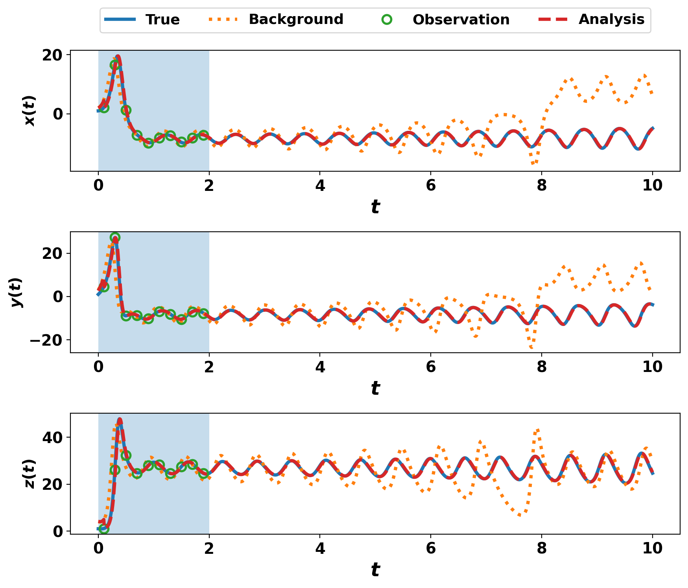

# ICESEE

ICESEE (ICE ShEet State and Parameter Estimator) is a data assimilation software framework designed for coupling with ice-sheet, climate, and geophysical models such as ISSM, Icepack, and idealized models such as the three-variable Lorenz system (the historical example directory is named `lorenz96`). It provides a modular and extensible platform for ensemble forecasting, state estimation, parameter estimation, and uncertainty quantification across a wide range of scientific modeling applications.

---

## What is ICESEE?

ICESEE (ICE ShEet state and parameter Estimator) is a scalable ensemble-based data assimilation framework designed for coupling with ice-sheet, climate, and geophysical models such as ISSM, Icepack, and idealized systems like the Lorenz system.

ICESEE provides a modular and extensible scientific computing infrastructure for ensemble forecasting, uncertainty quantification, and parameter estimation workflows in large-scale environmental modeling.

The framework supports:
- Ensemble-based data assimilation methods
- Distributed-memory HPC execution
- Cloud-enabled scientific workflows
- Cross-language model coupling

---

## Getting Started

To get started with ICESEE:

- Installation Guide
- Using ICESEE
- Build ICESEE as a Package
- Developmental Notes

### Related Projects

| Project | Description |
|----------|-------------|
| ICESEE-Spack | HPC and cluster deployment |
| ICESEE-Containers | Containerized execution environments |
| [CryoStack](https://cryostack.eas.gatech.edu/index.html) | Browser-based ICESEE workflows and access to local, HPC, and cloud resources |

>For Cluster installation and runs, see [ICESEE-Spack](https://github.com/ICESEE-project/ICESEE-Spack) or [ICESEE-Containers](https://github.com/ICESEE-project/ICESEE-Containers)
 and for browser-based ICESEE workflows, see [CryoStack](https://cryostack.eas.gatech.edu/index.html).

### ICESEE on CryoStack

ICESEE is available through [CryoStack](https://cryostack.eas.gatech.edu/index.html), Georgia Tech's integrated platform for cryosphere modeling, data assimilation, scientific visualization, and HPC-enabled research. The CryoStack ICESEE interface supports state estimation, parameter inference, and ensemble-based data-assimilation workflows while providing a consistent path from browser-based configuration to local, remote, HPC, or cloud execution resources.

---

## ICESEE CI Lorenz96 smoke test

The figure below comes from the automated workflow for the historical `lorenz96` path, whose current equations are the three-variable Lorenz-63 system. It serves as a lightweight end-to-end check of the framework.

**Figure:** Automatically generated by the ICESEE CI workflow after executing the three-variable Lorenz assimilation fixture. The figure compares the true trajectory, background forecast, synthetic observations, and ensemble analysis produced by ICESEE.

---

## Supported Models

- icepack: PDE-based ice-sheet modeling with Firedrake
- issm: Finite-element ice-sheet modeling via MATLAB coupling
- lorenz96: Idealized nonlinear data assimilation benchmark
- flowline_model: Simple ice-flow simulation

---

## Documentation

Explore the Wiki to find:

- Configuration and setup tips
- Model implementation guides
- Filter development and customization
- Data assimilation workflows
- Debugging and troubleshooting guides
- HPC deployment recommendations

For memory- and storage-bounded execution of large ensembles, including rolling
history, compact observations, restart behavior, and capacity limits, see the
[large-scale execution guide](docs/large-scale-execution.md).
The mode-2 parity contract and implemented native mode-3 architecture, including
adapter-specific capability limits, are documented in the
[mode-2 development contract](docs/execution-mode-2-development.md) and
[mode-3 design](docs/execution-mode-3-design.md), respectively.
Architectural decisions and their status (Proposed/Accepted) are tracked in
[`docs/architecture/`](docs/architecture/README.md); the model-adapter
boundary target is described in [`docs/model-adapter.md`](docs/model-adapter.md).

---

## Production handover and technical documentation

The [student and developer handbook](docs/handbook/README.md) documents the inspected `features_debug` implementation at commit `3748e416d3a8120cc860119bd7224c6f9ad41ff7`: [first run](docs/handbook/student-tutorial.md), [parallelization modes](docs/handbook/parallelization-modes.md), [architecture](docs/handbook/architecture.md), [analysis mathematics](docs/handbook/numerics.md), [literature](docs/handbook/literature.md), [configuration](docs/handbook/configuration.md), [HPC and containers](docs/handbook/deployment.md), [production and recovery](docs/handbook/operations.md), and [testing](docs/handbook/testing-and-contributing.md). The [technical-report preprint source](paper/production-report/README.md) explains the updated developments and their validation limits.

Use a unique output directory for a fresh run. Configuration loading can remove an existing `data_path`; `restart_enabled` alone does not protect it. Follow the documented explicit resume path before touching a valuable run. The [wiki](https://github.com/ICESEE-project/ICESEE/wiki) provides task-oriented entry points.

## Key Features

- Modular ensemble-based data assimilation framework
- State and parameter estimation capabilities
- Cross-language scientific model coupling
- Scalable HPC and distributed-memory workflows
- HDF5/NetCDF-based scientific data pipelines
- Containerized and cloud-enabled execution
- Extensible APIs for integrating external models
- Support for uncertainty quantification and ensemble forecasting
- Reproducible scientific computing infrastructure

---

## Future Directions

- Integration of scientific machine learning workflows into data assimilation pipelines
- Development of neural surrogate models for accelerated ice-sheet simulations
- Expansion of cloud-native and remote execution through CryoStack
- Expansion of distributed HPC workflows for large-scale ensemble forecasting
- Continued integration of ICESEE workflows and supported models into CryoStack
- Intelligent workflow orchestration and automated HPC diagnostics

- Machine learning–based parameter estimation
- Neural-network observation operators
- Adaptive covariance and inflation tuning
- Surrogate forward models for accelerated simulations
- Intelligent workflow automation and HPC optimization

These capabilities are under active development and are not yet part of the stable ICESEE release.

---

## Contributing

Contributions are welcome. See [CONTRIBUTING.md](CONTRIBUTING.md) for
development setup, the `icesee_kwargs` convention, model-integration and
MPI/HPC guidance, and testing expectations. Please open an issue or submit
a pull request through the GitHub repository.

For questions, suggestions, or collaboration opportunities:

Brian Kyanjo  
bkyanjo3@gatech.edu

---

## License

ICESEE is distributed as free and open-source software under the BSD 2-Clause License (see LICENSE).

External software packages and coupled models, including ISSM, Icepack, Firedrake, MATLAB-based components, and other third-party dependencies, remain subject to their respective licenses, which are independent of the ICESEE license.

Try the [sample runs](docs/handbook/sample-runs.md) before a larger experiment.
