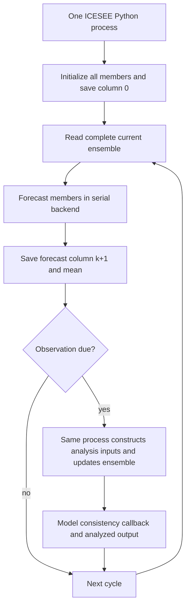
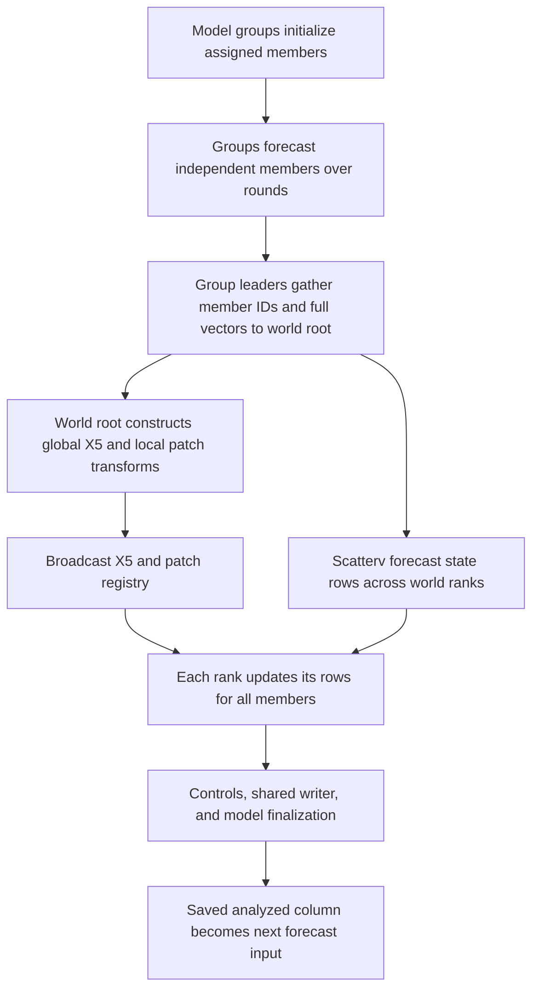
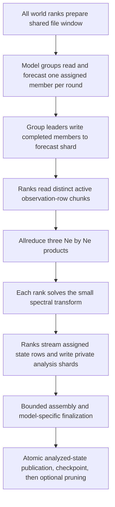
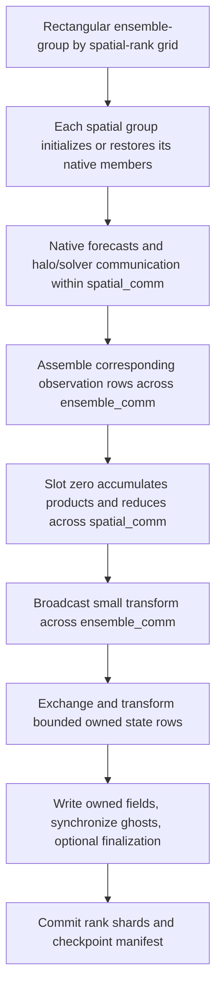

# Parallelization modes and the assimilation cycle

We distinguish four execution modes in ICESEE because the forecast, analysis, and storage stages have different computational requirements. Forecasting one ensemble member is largely independent of forecasting another. An analysis, however, combines information across members, and its communication pattern depends on whether we distribute members, state rows, or both. Writing a history introduces another requirement: the saved ensemble must describe the same completed physical state that the next forecast will use.

This guide follows the active drivers and their called routines. The numerical implementation baseline is commit `3748e416d3a8120cc860119bd7224c6f9ad41ff7`; subsequent documentation revisions do not change these runtime algorithms. We use `execution_mode` for the top-level selector and reserve *filter* for the statistical method. In particular, Mode 3 does not mean LETKF, and a scheduling flag does not select another execution mode. The [numerical chapter](numerics.md) gives the precise analysis-factor equations; here we explain where those operations occur and which data cross each boundary.

## Quantities that must remain distinct

Let `n` denote the packed state dimension, `Ne` the number of ensemble members, `m` the number of active observations, `P` the number of ICESEE MPI world ranks, and `S` the ranks cooperating on one model forecast. A member ID is a scientific identity in `0,...,Ne-1`; an MPI rank identifies a process. One process can advance several members over successive rounds, and several processes can cooperate on one member. We therefore do not equate the ensemble size with the MPI size.

We arrange an ensemble as an `n × Ne` matrix with members in columns. **Member distribution** assigns different columns to workers. **State-row distribution** assigns different rows to analysis workers. **Spatial model decomposition** assigns owned mesh degrees of freedom to collaborating model ranks, including the solver's halo communication. A row slab used in a matrix multiplication is not automatically a valid spatial partition for a PDE solver.

| Quantity or option | Meaning in the active code |
|---|---|
| `execution_mode` | Chooses the serial, partial-parallel, file-backed, or application-registered native runner. |
| `filter_type` | Statistical method name. Its presence in the parser does not establish support in every runner. |
| `default_run`, `sequential_run`, `even_distribution` | Historical scheduling selections within the configuration/manager layer. Their end-to-end wiring must be checked in the chosen driver. |
| `sequential_ensemble_initialization` | Initialization policy only; it does not mean that all later forecasts use `sequential_run`. |
| `ranks_per_model` | Generic resource-plan request for model-group size. Omission preserves the planner's legacy/default policy. |
| `model_nprocs` | Application solve setting. Native PIG uses it for spatial MPI groups; ISSM can use it for an internal external-model solve. |
| `state_distribution` | Whether the generic model-array boundary is replicated or consists of disjoint distributed pieces. |
| `analysis_backend` | A lower-level option in the serial EnKF class; it is not the canonical top-level runner selector. |
| `batch_size` | Mode-2 open-file window in state columns, not an ensemble mini-batch or a model timestep. |

In a replicated model, several model ranks may hold the same complete state; its global dimension is one local dimension. In a distributed model, owned pieces combine to cover the member once. Ghost values do not add new state rows. The Lorenz example declares replicated ownership, whereas native Firedrake layouts describe owned entries and synchronization explicitly. This distinction must be established before assigning a larger `S`.

## How the generic resource planner assigns work

[`plan_resources`](../../src/parallelization/parallel_mpi/resource_plan.py) computes a plan without launching MPI. If `ranks_per_model` is omitted, it chooses `S=1` when `Ne>=P`; when `P>Ne`, it uses `S=max(1,P//Ne)`. Explicit `auto` uses the latter floor-division rule, and a positive integer requests exactly that group size. The planner then forms at most `min(P//S,Ne)` groups, optionally limited further by a model-group cap such as the ISSM server count. Ranks after the last complete group are spare. Groups are block-contiguous in world-rank order.

For `G` groups, round `r` assigns member `g+r*G` to group `g`, provided that ID is smaller than `Ne`. Thus the number of rounds is `ceil(Ne/G)`, and the final round can contain idle groups. This is a statement about the plan. Each runtime path must also implement those rounds, spare-rank guards, and collective participant sets correctly. The Mode-2 forecast routine has an explicit unified round loop; some older Mode-1 branches still distinguish `Ne>=P` from `Ne<P` and should not be assumed to implement every possible plan.

### More members than ranks with the default single-rank grouping

For `P=8`, `Ne=12`, and omitted `ranks_per_model`, the generic plan has eight one-rank groups and two rounds:

| Round | Rank/group 0 | 1 | 2 | 3 | 4 | 5 | 6 | 7 |
|---|---|---|---|---|---|---|---|---|
| 0 | member 0 | 1 | 2 | 3 | 4 | 5 | 6 | 7 |
| 1 | member 8 | 9 | 10 | 11 | idle | idle | idle | idle |

This is the ordinary default forecast layout for the generic parallel paths in this regime. We have not obtained two spatial ranks per member merely by having eight ranks and twelve members. The active members are independent solves, each on one rank; after both rounds their results participate in the same twelve-member analysis.

For `P=Ne=8`, the same default gives eight one-rank groups and one round. For `P=10`, `Ne=4`, omitted grouping gives four two-rank groups and two spare ranks. The latter case requires both replicated/distributed ownership handling and safe treatment of ranks that belong to no model communicator. Mode-2 tests exercise such cases. A planner's valid mapping is not, by itself, evidence that another driver's initialization and forecast branches safely handle its spare ranks.

### An explicit spatial grouping

With `P=8`, `Ne=12`, and an adapter-supported explicit `S=2`, there are four groups and three rounds:

| Group | World ranks | Members processed in order |
|---|---|---|
| 0 | 0, 1 | 0, 4, 8 |
| 1 | 2, 3 | 1, 5, 9 |
| 2 | 4, 5 | 2, 6, 10 |
| 3 | 6, 7 | 3, 7, 11 |

The native PIG topology can express this layout through its own `model_nprocs=2` setting. We use this example below for Mode 3. The table is not a universal instruction to add `--ranks_per_model=2` to an arbitrary model: the manager validates registered capabilities, stochastic decomposition requirements, and, for selected models, node-local placement. ISSM's internal MATLAB/PETSc process count is a different boundary and must not be substituted for a generic spatial communicator size.

## Mode 0 serial orchestration

Mode 0 calls [`icesee_model_data_assimilation_serial`](../../src/run_model_da/icesee_da_serial.py). We use this path to make the complete assimilation cycle accessible on a small problem and to investigate serial filtering alternatives. The runner assigns its own ICESEE rank/size as zero/one. Launch it as one Python process. Launching several copies with `mpirun` does not convert it into Mode 1 and can create multiple apparent root writers.

### Initialization, forecast, and analysis

The runner resolves the model hooks, generates or reads truth/reference trajectories and synthetic observations, and calls the serial ensemble initializer. The resulting initial member values are saved at state column zero. At cycle `k`, it reads the complete current ensemble `ensemble[:,:,k]` from `icesee_ensemble_data.h5`. The EnKF class's serial forecast backend iterates over members, calls the model's forecast hook, and applies its configured member-wise process-noise policy. It then writes forecast members and their mean to column `k+1`.

When an observation is due, the same process reads observations, constructs the active observation covariance/operator inputs, and performs the selected analysis. The serial driver has explicit branches for `EnKF`, `DEnKF`, `EnRSKF`, and `EnTKF`. For EnKF/DEnKF it constructs a dense state covariance from ensemble anomalies before calling analysis; this stage can require `O(n²)` storage. A transform-based implementation elsewhere in ICESEE does not make this serial driver universally covariance-free. Serial availability also does not establish that each alternative method has been validated for every model and observation operator.

After analysis, an optional model callback restores physical consistency. Members and means are written to the completed state column, and the next cycle reads that analyzed state. Thus one process controls model calls, observation preparation, analysis, and output. The underlying model can still use its own external solver processes, but those are not ICESEE ensemble workers.



### Memory, communication, and use

There is no ICESEE member distribution or state-row scatter in the default serial backend. MPI may still be imported for timing and common utilities, so serial execution is not a promise that mpi4py is absent. The current ensemble and analysis objects must fit one process. HDF5 history avoids retaining every state column in one Python array during the loop, but the initializers and selected analysis can allocate additional full-sized arrays. Do not size this mode using only the final file's dimensions.

Mode 0 is the appropriate first step for the [small student exercise](student-tutorial.md), an operator/observation mapping investigation, or a serial-method comparison. It does not establish multi-rank collective safety. Its lifecycle also does not provide the specialized PIG native checkpoint manager; do not infer a supported arbitrary restart from the existence of a common `restart_enabled` key.

## Mode 1 partial parallel orchestration

Mode 1 calls [`icesee_model_data_assimilation_partial_parallel`](../../src/run_model_da/icesee_da_partial_parallel.py). In its ordinary `default_run` path, forecasts are distributed over model groups, while the global analysis transform is constructed on world rank zero. State-row multiplication is then shared over world ranks. We call this *partial parallel* because not every stage has the same distribution; it does not mean that only the forecast has parallel work.

### Initialization and forecasting

The manager creates model communicators from the resource plan. Reference generation and observation setup have designated writers and synchronization, and the MPI initializer constructs members using stable member IDs and model hooks. The `sequential_ensemble_initialization` setting can serialize setup even when subsequent forecasts are parallel. This can be useful for adapters whose expensive setup or file access cannot be safely replicated; it should be recorded with initialization timings.

For `P=8`, `Ne=12`, default single-rank grouping, the forecast routine advances members 0–7 in the first round and 8–11 in the second. Each active group reads its member's current state, calls `advance_ensemble_member`, and obtains its updated values. Group leaders send member IDs and completed vectors through a leader communicator to world rank zero. The receiving root places each vector into the correct column of the full forecast ensemble; arrival/rank order must not replace member identity.

The ordinary forecast function allocates a complete `n × Ne` result array, and world rank zero needs the assembled ensemble. Some non-root paths also allocate full-shaped work arrays. We therefore do not claim per-rank `n*Ne/P` memory for Mode 1. If a model uses several ranks per solve, its actual owned/distributed return convention must still be honored; full-vector transfer at the generic boundary can remain even when the solver itself is parallel.

### Observation work, transform, and state update

At an analysis event, the ordinary path loads observation values and masks, and world rank zero calls `EnKF_X5`. It evaluates forecast equivalents, forms the configured observation-error factor, and constructs the small global transform `X5`; grouped local transforms can also be prepared there. The selected factor matters statistically: `legacy_prior_anomalies` reuses forecast anomalies, while `stochastic_R` and `generated_R` use explicit perturbation factors. Those choices are described in [numerics](numerics.md).

`analysis_enkf_update` broadcasts `X5` and the local-patch registry. It divides state rows with balanced counts, then `Scatterv` sends each rank an `n_local × Ne` forecast slab. Every rank computes `forecast_slab @ X5`, replaces selected rows with grouped local transforms where requested, and applies the shared row-local analysis controls. The writer then handles output and any model/global finalization. This distribution changes at the forecast/analysis boundary: ranks that owned particular members during forecast now work on rows spanning **all** members.

The root's factor construction and SVD retain observation-by-member arrays, approximately `O(m*Ne)` each, in addition to the complete state ensemble. Some setup/driver paths load dense observation histories on other ranks as well. Calling the result a small transform therefore describes the final `Ne × Ne` matrix, not the entire memory used to construct it. This is the important difference from Mode 2's row-streamed product construction.



This scheme follows the useful separation between ensemble-space algebra and state-space application: a small member-space transform can be reused across many state rows. Ensemble representations and numerical implementation choices are discussed by [Evensen (2003)](https://doi.org/10.1007/s10236-003-0036-9). That literature provides context, while ICESEE's exact finite-sample factor and truncation remain defined by its code.

### Partitioned I/O and limits

`partitioned_io_flag=True` selects a separate Mode-1 path. Forecast members are written directly to shared HDF5 rather than gathering a full ensemble for the ordinary root path. The partitioned analysis routines read distributed rows and reduce analysis products collectively. This is an explicit alternative within Mode 1, not another name for Mode 2; its supported options and finalization boundaries must be checked separately. For example, the partitioned EnKF branch rejects a restricted `bed_update_domain`, and the driver explicitly refuses partitioned DEnKF.

The active production explanation here concerns EnKF with `default_run`. Although Mode 1 recognizes other filter names and contains DEnKF-related routines, branch presence is not evidence of a working, parity-tested configuration. The current DEnKF call interfaces require independent validation before use. Likewise, the general planner can represent spare ranks or additional rounds, but older Mode-1 initializer/forecast branches still use `Ne>=P` tests and direct subcommunicator queries. Use a demonstrated topology, rather than assuming every mathematically valid plan executes safely in this path.

## Mode 2 file-backed and bounded-row analysis

Mode 2 calls [`icesee_model_data_assimilation_full_parallel`](../../src/run_model_da/icesee_da_full_parallel.py) and uses [`EnKF_fully_parallel_IO`](../../src/parallelization/EnKF_parallel_io.py). Here we retain ensemble state in timestep files and stream observation/state rows during analysis. This removes the ordinary Mode-1 requirement that world rank zero assemble the complete forecast ensemble for global analysis. It does not remove the state needed by an individual generic model forecast.

### Initialization and model forecasts

Every world rank constructs the I/O layer and participates in its required shared setup. The full-parallel initializer writes the initial state at shard zero. Depending on the initialization policy, members can be initialized in groups or prepared by root and written through a collective root-to-row distribution. A rank-zero reuse decision is broadcast so ranks do not disagree about whether to initialize or enter later collectives.

The active file-backed cycle uses `default_run`. It follows the centralized plan in a unified round loop for both `Ne>=P` and `Ne<P`. Active groups read one current member from the shared state shard, advance it, and write its completed state at shard `k+1`. A distributed generic model can update only part of that vector on each model rank; the routine gathers the freshly owned pieces to the group leader before its full-member write. Replicated model copies do not need that assembly. This is why Mode 2 can bound ensemble-analysis memory while still using a full-member array on a group leader.

The generic `read_forecast` returns a complete member vector to its caller. Consequently model ranks can retain an `O(n)` NumPy buffer even when the PDE solver uses a spatial communicator. We should not infer `O(n/S)` Python-state storage from solver parallelism alone; the native field boundary in Mode 3 addresses that separate representation issue.

Spare world ranks do not enter model callbacks or call methods on `COMM_NULL`. They do, however, join the world-level file-window priming operation and other shared I/O-layer collectives. Groups with no member in the last round also remain consistent with those participant sets. The primed window covers the state being read and the state being written; subgroup-root writes must find it already available rather than initiating an unmatched collective open.

The I/O class's `self.nt` is the number of **saved state columns**, set to the driver's forecast count plus one. The driver loops over forecast cycles `0,...,nt-1`; the final advanced state is shard `nt`. When following index arithmetic inside `compute_analysis_update`, first account for this constructor normalization. Otherwise a correct `k+1` mapping can be mistaken for a terminal-time exception.

### Observation rows and the small transform

The indexed observation operator records selected state rows rather than allocating a dense `m × n` matrix. Compact synthetic observations store active observed values, standard deviations, IDs, and masks. The analysis divides observation positions among world ranks and reads only each rank's active row chunks from the immutable forecast shard. For a global EnKF update, every observation contributes once to three `Ne × Ne` products:

```text
F = Yprime + Eta
C_local += Yprime.T @ F
G_local += F.T @ F
B_local += F.T @ D
```

Three `Allreduce(SUM)` operations form the global products. Each participating rank then computes the small spectral transform locally; this differs from the ordinary Mode-1 root computation followed by broadcast. We do not communicate a state covariance. The exact transform is `I + C @ Gplus @ Gplus @ B`, with spectral truncation, as derived in the numerical chapter.

To preserve the canonical random sequence for explicit observation factors, rank zero writes an observation-sized temporary factor file in the configured canonical order. Other ranks read their row portions after synchronization. Thus global analysis is row-distributed, while factor preparation still includes root work and I/O. For `generated_R`, the field generator can also require a state-sized per-column workspace. Claims about bounded analysis must name these auxiliary stages rather than treating every temporary as `Ne × Ne`.

### State update and publication

After products are reduced, each rank reads chunks within its assigned state-row interval, multiplies those rows by `X5`, applies local patches and shared controls, and writes a private serial analysis shard. Bounded assembly combines these rank shards; application finalization, geometry/inference, and optional member-wise inversion occur before atomic publication of the analyzed state. Means derived after finalization refer to the same published state used for restart.



Not all analysis branches have the same bound. Exact grouped local analysis in this I/O class gathers active observation factors to rank zero, checks `local_analysis_memory_budget_mb`, constructs the grouped transforms there, and broadcasts the patch registry. Some inference/finalization operations also require member slabs or ensemble-coupled root work under separate budgets. Reducing `analysis_row_chunk_size` does not reduce those independent allocations.

### Retention, restart, and communication requirements

Full history costs approximately `n*Ne*(nt+1)*b` stored bytes before means, truth, checkpoints, temporary files, and overhead. Rolling history retains the restartable state and active window, so retained member history does not grow indefinitely with run length. It cannot reconstruct pruned historical spread. `auto` can choose retention from projected capacity; set and verify an explicit policy when the experiment requires complete members at every time.

The driver writes its completion checkpoint before pruning a rolling shard. Full-history finalization can publish a VDS over timestep sources. Preserve those sources and their layout when archiving. The minimum two-shard window is an I/O safety/working-set decision, not a reduction in ensemble size.

Parallel HDF5 has specific collective requirements on the file-opening communicator. Some metadata operations require coordinated calls, whereas raw dataset reads/writes can use independent or collective transfers. It is therefore inaccurate to say that every HDF5 read is collective, or that a root-only dataset write can safely perform any metadata operation it happens to need. See the [HDF Group collective-call requirements](https://support.hdfgroup.org/documentation/hdf5/latest/collective_calls.html) and [h5py parallel-HDF5 guide](https://docs.h5py.org/en/3.15.0/mpi.html). ICESEE's window preparation and immutable analysis-reader phases enforce this distinction in the selected path.

The maintained Mode-2 lifecycle described above is `default_run` with EnKF. The parser/manager retain historical sequential/even selections and the driver recognizes additional filter strings, but its active forecast/analysis block is not equivalently implemented for all those choices. Use the actual full-cycle tests, not a recognized CLI option, as the support criterion.

## Mode 3 application-specific native execution

Mode 3 first calls [`icesee_da_distributed.py`](../../src/run_model_da/icesee_da_distributed.py), which looks up an application-scoped registration. It then delegates to that application's runner. We use this mode to retain native model fields and, where the adapter genuinely exposes them, spatial ownership throughout the forecast/analysis interface. A registration identifies a lifecycle; it does not make all registered applications spatially distributed or scientifically equivalent.

### Native topology and persistent fields

[`create_distributed_topology`](../../src/parallelization/distributed_topology.py) builds a rectangular `P=G*S` grid. `spatial_comm` contains all spatial ranks of one ensemble group. `ensemble_comm` contains corresponding spatial positions across groups. The native topology has no spare-rank remainder: the requested dimensions must factor the world size, and the native pool rejects an ensemble slot with no member. This differs from the generic planner's ability to leave spare ranks outside model groups.

For native PIG with `P=8`, `Ne=12`, `model_nprocs=2`, the four spatial groups and member assignments are those in the explicit-group table above. `ensemble_comm` at spatial position zero joins ranks 0,2,4,6; the communicator at spatial position one joins ranks 1,3,5,7. Each spatial group forecasts its three members. A `NativeDistributedMember` retains model fields and an opaque context, while the field registry packs only owned entries when analysis/checkpoint code needs them. Ghost synchronization remains the model adapter's responsibility.

Initialization constructs or restores these native objects and validates exact state coverage. Serial reference observations can have a different mesh numbering from distributed model rows, so PIG maps physical coordinates to canonical observation positions before routing values or process-noise increments. Matching vector length alone would not establish that the same locations are being assimilated.

### Forecast, observation reduction, and analysis

In `run_native_global_analysis_cycle`, the pool advances assigned native members using each spatial communicator. It evaluates locally owned observation equivalents, then assembles the selected rows across `ensemble_comm` in stable member-column order. Ranks sharing a spatial position must agree on their active observation IDs and batch order, while different spatial positions can own different observation batches.

Only ensemble slot zero accumulates the local observation products. Those products are reduced across its `spatial_comm`, avoiding counting each observation once per ensemble group. The small transform and any collective refusal reason are then broadcast across corresponding `ensemble_comm`s. State-row blocks spanning members are exchanged across ensemble groups, transformed, and written back to the owned native fields. An optional application callback can modify geometry or diagnostics at finalization. The current native PIG binding performs ghost synchronization without a state-modifying finalizer; its next forecast recomputes geometry and diagnostic velocity. Optional inversion likewise requires the appropriate adapter and analysis policy.



The diagram describes the native global-analysis building block, not every registered runner. There is also a grouped-local native cycle and a whole-member file-backed analysis policy. The choice belongs to the application's binding and scientific feature set. The local ensemble transform Kalman filter of [Hunt, Kostelich, and Szunyogh (2007)](https://doi.org/10.1016/j.physd.2006.11.008) is a distinct local deterministic filtering method; its name should not be used as a synonym for this process grid or ICESEE's selected stochastic factor update.

### Persistent members, streaming, and the remaining memory costs

By default, `NativeDistributedMemberPool` retains every member assigned to a slot. In the twelve-member/four-group example that means three native member contexts per group, not just the one currently being advanced. Native ownership removes a complete-member gather in the spatial PIG path, but the retained number of local contexts can still dominate memory.

`use_member_streaming=True` can select a streaming pool when the adapter implements reactivation. It keeps at most one active native member and stores the other assigned members' packed owned arrays. A memory store removes inactive solver/context overhead but still retains their packed state in RAM. `member_store_backend=hdf5_member_major` moves that backing to files; `use_store_streaming_analysis` additionally selects row-wise store analysis where the application wires it. These are separate controls, and an adapter without reactivation is not made streaming merely by a flag. Working member-store files are not committed restart checkpoints.

PIG's canonical process-noise decorator retains another limit: a group leader generates a global-sized stochastic increment, then scatters owned pieces. This is not a gathered physical member, but it is `O(n)` workspace with a 256 MiB guard. Its graph cache has a separate 64 MiB per-process limit. Spatial native execution should therefore be described by the bound of each stage, not by an unconditional assertion that no process ever allocates anything global-sized.

### Application capabilities and output

| Registered application | Implemented boundary and principal restrictions |
|---|---|
| Lorenz `lorenz96` example | Tiny whole/replicated state; specialized native runner; legacy and stochastic-R factors; gathers small snapshots for legacy HDF5 output. Not evidence for distributed glacier fields. |
| Icepack `idealized_pig` | Native Firedrake owned fields; spatial groups, specialized checkpoint/replay and history export; legacy and stochastic-R factors. Current PIG runner uses its bound global-analysis policy; additional generic native/local infrastructure is not an automatic feature promise for this example. |
| Icepack `synthetic_ice_stream` | Whole-member adapter with one spatial rank; shared native lifecycle plus `FileBackedNativeAnalysis`, reusing the file-backed analysis operator for declared localization/inference features. Shared lifecycle rejects requested resume. |
| Flowline `flowline_1d` | Specialized small-model/whole-member lifecycle; sharded native history; legacy and stochastic-R factors; no model inversion mechanism in that binding. |
| ISSM `ISMIP_Choi` | Complete-member Python/MATLAB boundary; round scheduling and inversion policy; internal ISSM solve ranks are separate. Writes checkpoint shards but has no native restore path. Persistent local member arrays are not reduced to one by a streaming flag. |

Registration is not evidence that every entry has the same tested `Ne`, process count, restart policy, filter support, or real-data skill. In particular, the shared `native_application` policy enforces one spatial rank, rejects resume, and rejects scientific feature flags unless the binding declares them. Specialized runners must be read and validated separately. Current native runner error-factor checks also mean that the presence of `generated_R` in generic Mode 2 should not be projected onto every native application.

Native checkpoint manifests bind member identity, layout, progress, and policy to rank-owned shards. For a runner with implemented restore, a completed cycle `k` resumes at cycle `k+1`, after analysis already applied to that saved state. The current ISSM Choi native runner writes checkpoint shards but has no load/restore/resume path; checkpoint creation alone is not restart support. Native PIG can export retained checkpoints into a standalone aggregate history in bounded rows. Other adapters can use a different output schema; an existing notebook expecting the generic HDF5 layout will not necessarily read their native shards directly.

## Choosing and comparing modes

We choose the mode from the model boundary and the part of the workflow that limits the intended experiment. A fast analysis cannot compensate for a single forecast that does not fit its model ranks, and a spatial solver does not by itself provide a bounded complete history.

| Situation | Starting choice | Evidence required before larger use |
|---|---|---|
| Learn a new adapter/operator on a small state | Mode 0 | Initial state, forecast and analysis shapes, observation timing, physical consistency. |
| Compare serial filtering variants | Mode 0, selected serial method | Method-specific numerical tests and relevant model experiment; do not infer parallel availability. |
| Parallel forecasts with a manageable current ensemble | Mode 1 EnKF/default path | Target-model/topology completion and member-wise control comparison; inspect root memory. |
| Full ensemble history is too large for the ordinary memory path | Mode 2 EnKF/default path | Full/rolling policy, capacity, coherent MPI/HDF5 stack, same-input Mode-1 parity, and restart/output verification. |
| A physical PIG member needs native spatial decomposition | Registered PIG Mode 3 | Supported spatial layout, node-local groups, owned-field/observation mapping, spread, restart and physical acceptance. |
| Many round-assigned native contexts exceed RAM | A supported native streaming/store policy | Activation/store/analysis traffic measurements and numerical/restart equivalence; not just a reduced context count. |
| Another model or an unlisted feature combination | Established model-specific baseline | Inspect registration/capabilities and demonstrate the complete requested cycle before claiming support. |

For the small tutorial, keep the same full YAML and use separate output directories. The existing commands in [student onboarding](student-tutorial.md) and the [paired Mode-1/Mode-2 harness](testing-and-contributing.md#modes-1-and-2-parity) are the runnable starting point. The harness preserves source/configuration identity and forces full float64 histories so all members can be compared. For a PIG native run, use its [application README](../../applications/icepack_model/examples/idealized_pig/README.md) and approved scheduler/environment resolver; changing the mode flag on a Lorenz command does not prepare a glacier calculation.

Same-input Mode-1/Mode-2 parity requires the same realized prior, observations, member IDs, seeds, process-noise schedule, factor mode, controls, solver settings, and storage precision. Compare members and means, the observation/state clock, and the post-analysis physical fields. Mode 0 has a separate serial analysis path, and native initialization/noise can differ from generic initialization; equal filter labels do not make all four results a single controlled parity experiment.

Finite-ensemble covariance estimates also remain sensitive to observation support and sampling. [Houtekamer and Mitchell (1998)](https://doi.org/10.1175/1520-0493(1998)126%3C0796:DAUAEK%3E2.0.CO;2) provide early ensemble-assimilation context for those statistical issues. Communicator layout and row streaming address computational ownership; they do not remove the need to evaluate localization, uncertainty, and posterior behavior.

Finally, distinguish operational measurements from scaling experiments. A Mode-3 run with sixteen ranks and two ranks per model cannot establish speedup over a concurrent eight-rank Mode-1 run. Hold the scientific problem, initialization, solver stack, retention and I/O protocol fixed; define which process-grid dimension changes; record repeated wall times, per-rank memory, and storage traffic. Report simulation, output publication, and verification separately. The available production records establish their recorded configurations, while the [readiness checklist](production-readiness.md) identifies what a new case still has to demonstrate.

## Implementation reading sequence

Begin with [`run_models_da.py`](../../src/run_model_da/run_models_da.py) and `normalize_execution_mode` in [`icesee_context.py`](../../src/utils/icesee_context.py). Follow the selected runner, then these boundaries:

1. [`resource_plan.py`](../../src/parallelization/parallel_mpi/resource_plan.py) and the MPI manager establish generic member/group mapping. [`distributed_topology.py`](../../src/parallelization/distributed_topology.py) establishes the distinct native process grid.
2. [`_mpi_ensemble_intialization.py`](../../src/parallelization/_mpi_ensemble_intialization.py) and [`_mpi_forecast_functions.py`](../../src/parallelization/_mpi_forecast_functions.py) show initialization, member rounds, generic state transfer, and noise.
3. [`_mpi_analysis_functions.py`](../../src/parallelization/_mpi_analysis_functions.py) shows ordinary Mode-1 root/row analysis and the partitioned alternative. [`EnKF_parallel_io.py`](../../src/parallelization/EnKF_parallel_io.py) shows Mode-2 observation products, local-analysis exceptions, state streaming and publication.
4. [`distributed_native_runtime.py`](../../src/parallelization/distributed_native_runtime.py), [`distributed_native_cycle.py`](../../src/parallelization/distributed_native_cycle.py), and the application's `mode3_runner.py` show which native capabilities are actually wired.
5. [`mode3_checkpointing.py`](../../src/parallelization/mode3_checkpointing.py), [`distributed_checkpoint.py`](../../src/parallelization/distributed_checkpoint.py), and [`distributed_history_export.py`](../../src/parallelization/distributed_history_export.py) show retention, commit, resume, and exported-history semantics.

When reading a collective, identify its communicator and all intended participants. The [MPI standard](https://www.mpi-forum.org/docs/mpi-5.0/mpi50-report.pdf) specifies communicator/collective semantics; an MPI library version such as Open MPI 5.0.9 is an implementation identifier, not the MPI standard's version. Use the functional launcher probe and actual process ranks in the testing guide before accepting a parallel test. This final check connects the conceptual process grid to the program that truly ran.
