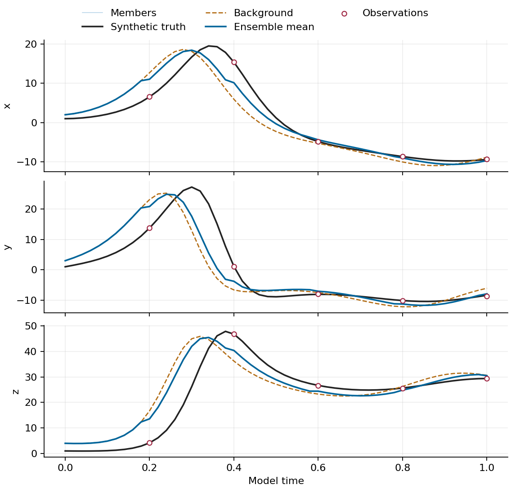

# Parallel-mode endpoint experiment

This fixture connects the mode descriptions to executable commands. It uses the repository's three-variable Lorenz system (historical directory name `lorenz96`), eight members, 50 forecast cycles, and observations at 0.2, 0.4, 0.6, 0.8 and 1.0 model-time units. The final observation belongs to state column 50.

Activate a coherent Python/MPI/HDF5 environment and establish imports as described in the student tutorial. Confirm the launcher is compatible with `mpi4py` and `h5py.get_config().mpi` is true. From a checkout named `ICESEE`, use a new directory for every invocation:

```bash
export ICESEE_ROOT="$(pwd -P)"
export PYTHONPATH="$(dirname "$ICESEE_ROOT"):$ICESEE_ROOT${PYTHONPATH:+:$PYTHONPATH}"
export OMP_NUM_THREADS=1 OPENBLAS_NUM_THREADS=1 MKL_NUM_THREADS=1
CASE_ROOT="$(mktemp -d "${TMPDIR:-/tmp}/icesee-endpoint.XXXXXX")"
for mode in 1 2 3; do
  "$MPIEXEC" -np 2 python \
    "$ICESEE_ROOT/applications/lorenz_model/examples/lorenz96/run_da_lorenz96.py" \
    -F "$ICESEE_ROOT/paper/production-report/experiments/lorenz-endpoint.yaml" \
    --execution_mode="$mode" --model_nprocs=1 \
    --data_path="$CASE_ROOT/mode$mode" \
    > "$CASE_ROOT/mode$mode.log" 2>&1
done
```

Set `MPIEXEC` to the functionally tested launcher; use the scheduler-approved form on allocated HPC resources. These commands describe a local example, not a production allocation request.

The recorded runs exited zero and produced finite member histories of shape `(3,8,51)`, with means consistent with members. Modes 1 and 2 emitted five analysis records at columns 10, 20, 30, 40 and 50. Their maximum absolute member differences were `5.3071289585204795e-9` over the history and `9.100062925426755e-10` at the final state, within `rtol=atol=1e-7`. Mode 3 reported five analyses in its performance record, but does not emit the same audit-line format. It is checked for completion and integrity here; three-mode member equivalence is not claimed because initialization and stochastic policies differ.

`mode-smoke-results.json` records the fixture identity, dimensions and comparisons. Tiny local elapsed times are not performance results. The driver counts forecast advances, while Mode-2 I/O stores one additional column for the initial state; both definitions determine terminal-state mapping.

After every writer has closed, verify each history from the repository root:

```bash
python scripts/docs/verify_sample.py "$CASE_ROOT/mode2/icesee_ensemble_data.h5" \
  --members 8 --columns 51 --rows 3
```

The checker reads bounded row/time slabs, rejects missing virtual backing files, nonfinite arrays and inconsistent stored means. It does not establish observation timing or physical skill. Preserve each complete output directory, including its backing shards.

The [sample-run route](../../../docs/handbook/sample-runs.md) connects this experiment to the new coarse Icepack case and the two ISSM teaching protocols. Their backend requirements and execution evidence are recorded separately.

`lorenz-traces.csv` retains the numerical data from the executed Mode-1 fixture. Rebuild its three-component trace with:

```bash
python paper/production-report/experiments/plot_lorenz.py
```

The plot is a teaching view of the recorded trajectories, members and observations. This single small realization is not a controlled estimate of filter skill or calibrated uncertainty.


